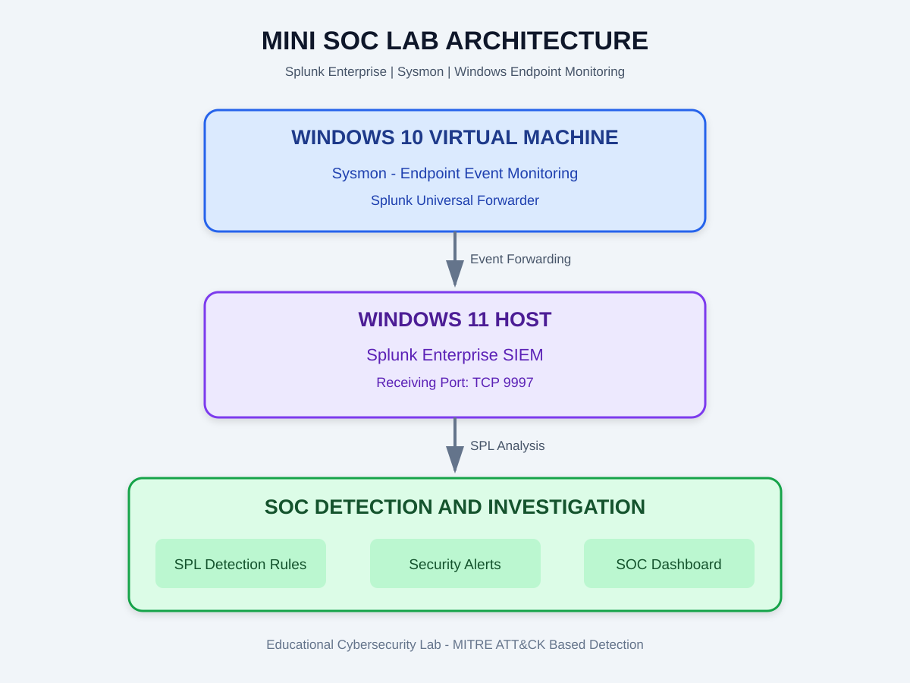

# Mini SOC - Splunk Threat Detection Lab


## Project Overview

This project demonstrates a Security Operations Center (SOC)
monitoring and threat detection lab using Splunk Enterprise,
Windows Event Logs and Sysmon telemetry.

The purpose of this project is to understand endpoint security
monitoring, identify suspicious activities, develop SPL-based
detection searches and investigate security alerts.

The lab uses a Windows 10 virtual machine as the monitored
endpoint and a Windows 11 host running Splunk Enterprise
as the SIEM platform.

## Project Objectives

- Collect Windows security and Sysmon event logs.
- Forward endpoint telemetry to Splunk Enterprise.
- Analyze raw Windows XML event data.
- Develop SPL-based threat detection searches.
- Map detection use cases to MITRE ATT&CK.
- Configure alerts for suspicious activities.
- Visualize security events through a SOC dashboard.

## Tools and Technologies

| Tool | Purpose |
|---|---|
| Splunk Enterprise | SIEM and log analysis |
| Splunk Universal Forwarder | Log forwarding |
| Sysmon | Windows endpoint monitoring |
| Windows 10 VM | Monitored endpoint |
| Windows 11 | Host and Splunk environment |
| PowerShell | Attack simulation and administration |
| SPL | Detection query development |
| MITRE ATT&CK | Threat technique mapping |
| VMware | Virtualization |

## Lab Architecture

The lab follows this general telemetry flow:

1. Sysmon generates endpoint activity events inside
   the Windows 10 virtual machine.
2. Splunk Universal Forwarder collects configured logs.
3. Events are forwarded to Splunk Enterprise on the
   Windows 11 host.
4. Splunk searches analyze the collected telemetry.
5. Detection searches identify potentially suspicious
   activities.
6. Alerts and dashboards support security investigation.



## MITRE ATT&CK Detection Use Cases

### 1. PowerShell Execution

- MITRE ATT&CK ID: T1059.001
- Technique: PowerShell
- Objective: Identify potentially suspicious PowerShell
  execution, including encoded commands and download cradles.
- Detection file: detections/T1059_001_powershell.spl

### 2. LSASS Memory Credential Dumping

- MITRE ATT&CK ID: T1003.001
- Technique: LSASS Memory
- Objective: Identify potentially suspicious access to
  the Local Security Authority Subsystem Service (LSASS).
- Detection file: detections/T1003_001_lsass_dump.spl

### 3. Scheduled Task Persistence

- MITRE ATT&CK ID: T1053.005
- Technique: Scheduled Task
- Objective: Identify potentially suspicious scheduled
  task creation and persistence-related activity.
- Detection file: detections/T1053_005_persistence.spl

## XML Parsing Engineering Decision

Splunk ingested raw XmlWinEventLog telemetry without
the Windows Technical Add-on (TA).

To work with the raw XML event structure, inline regex
extraction using the SPL rex command was implemented
in detection searches.

The extraction approach targets nested XML Data Name
attributes and relevant fields such as User, ParentImage,
Image and CommandLine.

This engineering decision allows detection searches
to extract useful information directly from raw XML
event data.

Note: The extracted fields depend on the actual XML
event structure and the rex expressions implemented
in each detection search.

## Project Structure

```text
Mini-SOC-Splunk-Threat-Detection/
|
|-- README.md
|-- architecture_diagram.svg
|-- .gitignore
|
|-- detections/
|   |-- T1059_001_powershell.spl
|   |-- T1003_001_lsass_dump.spl
|   |-- T1053_005_persistence.spl
|
|-- screenshots/
    |-- 01_sysmon_ingestion.png
    |-- 02_attack_simulation.png
    |-- 03_triggered_alert.png
    |-- 04_soc_dashboard.png
```

## Screenshots and Evidence

The screenshots folder contains visual evidence of the
lab environment and detection workflow.

| Screenshot | Description |
|---|---|
| 01_sysmon_ingestion.png | Sysmon event ingestion in Splunk |
| 02_attack_simulation.png | Authorized lab attack simulation |
| 03_triggered_alert.png | Splunk triggered alert |
| 04_soc_dashboard.png | SOC monitoring dashboard |

## Learning Outcomes

Through this project, the following concepts are explored:

- SIEM fundamentals and log monitoring.
- Windows endpoint security monitoring.
- Sysmon event analysis.
- SPL search and detection development.
- Regex-based XML field extraction.
- MITRE ATT&CK framework mapping.
- Security alert configuration.
- Basic threat investigation and analysis.

## Security Disclaimer

This project is intended strictly for educational and
defensive cybersecurity purposes.

All testing and simulations should be conducted only
within an isolated environment where authorization
has been obtained.

The detection results indicate potentially suspicious
activity and should be investigated before confirming
a security incident.

## Author

Rahul Ramesh Mhatre

Cybersecurity | SOC Analyst | Blue Team Enthusiast

GitHub: https://github.com/rahulmhatre10

---

**Mini SOC - Splunk Threat Detection Lab**
